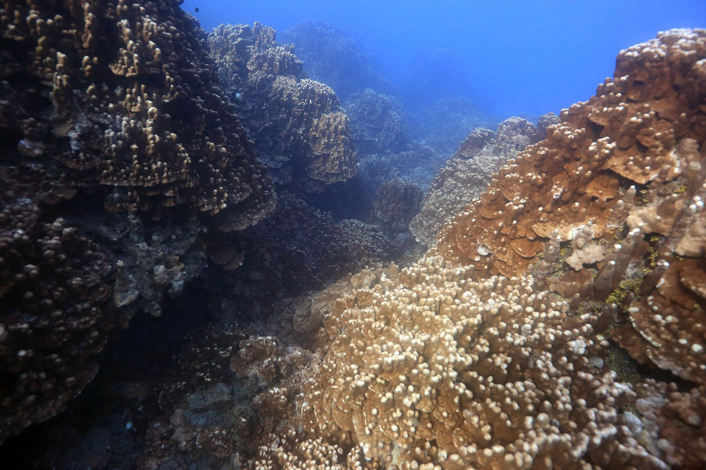
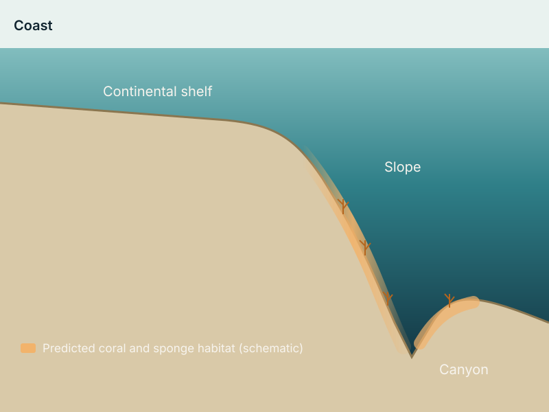
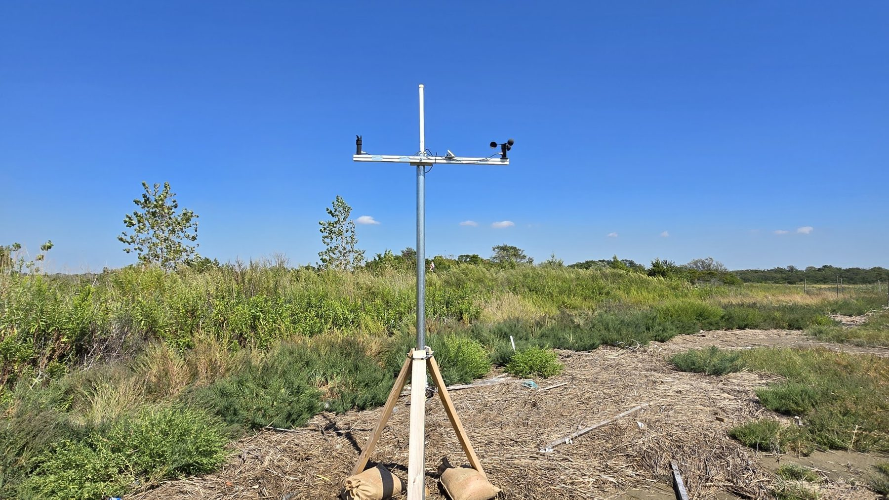

::: {.hero style="background-image: url('images/reef-diver.jpg');" role="img" aria-label="A diver swims above a shallow coral reef with a large coral colony in the foreground."}
::: hero-text
[PhD Candidate · Marine Ecology · CUNY]{.role}

# James J. Herlan

I study how waves, flow and habitat structure decide where corals and other foundation species live, and how they hold together after disturbance.
:::
[Photo: Sly Lee]{.hero-credit}
:::

## About

I'm a marine ecologist and PhD candidate in Ecology, Evolutionary Biology, and Behavior at The Graduate Center, City University of New York. I'm co-advised by [Dr. Phillip Staniczenko](https://staniczenkoresearch.net) (Brooklyn College) and Dr. Kyle McDonald (City College). I combine scuba-based fieldwork with Structure-from-Motion photogrammetry, spatial statistics and machine learning. I've done this work on coral reefs at Rapa Nui (Easter Island) and in the U.S. Virgin Islands, on the deep Northeast U.S. continental shelf, and in the salt marshes and oyster reefs of New York Harbor.

My path into spatial ecology began with more than a decade of field and restoration work. I helped develop nursery methods for the threatened staghorn coral at the University of Miami. With the U.S. Geological Survey in St. John, I documented diverse coral communities growing in mangrove-lined bays, a habitat once thought unsuitable for reef-building corals ([Yates et al. 2014](https://doi.org/10.5194/bg-11-4321-2014)). I then spent several years on Rapa Nui with Chile's Millennium Nucleus for Ecology and Sustainable Management of Oceanic Islands. After that, I trained in large-area imaging and spatial point pattern analysis in Dr. Stuart Sandin's lab at Scripps Institution of Oceanography.

My goal is to bridge ecological theory and conservation practice, and to give managers spatially explicit tools for protecting marine habitats as conditions change.

::: facts
::: fact
[Now]{.k}

[Research Associate, North Atlantic Coast CESU (Sandy Hook, NJ)]{.v}
:::
::: fact
[Fellowship]{.k}

[NOAA-EPP/MSI CESSRST-II Fellow]{.v}
:::
::: fact
[PhD defense]{.k}

[December 2026]{.v}
:::
::: fact
[Field credentials]{.k}

[AAUS scientific diver · NOAA MOCC]{.v}
:::
:::

## Research themes

```{=html}
<div class="theme-grid">
  <a class="theme-card" href="research.html#reef-assembly-at-rapa-nui">
    
    <div class="body"><h3>Reef assembly at Rapa Nui</h3>
    <p>How wave exposure and habitat structure filter which corals live where, read from 3D reef models and spatial point patterns.</p></div>
  </a>
  <a class="theme-card" href="research.html#seafloor-habitat-at-shelf-scale">
    
    <div class="body"><h3>Seafloor habitat at shelf scale</h3>
    <p>Ensemble species distribution models for deep-sea corals and sponges on the Northeast U.S. continental margin.</p></div>
  </a>
  <a class="theme-card" href="research.html#urban-coastal-restoration">
    
    <div class="body"><h3>Urban coastal restoration</h3>
    <p>Sensor networks and models of waves, water level and nitrogen at New York salt marsh and oyster restoration sites.</p></div>
  </a>
</div>
```

## Recent news

<ul class="news">
<li><span class="when">Aug 2026</span><span>Spatial ecology of the Rapa Nui reefs published online in <em>Marine Ecology Progress Series</em>. <a href="https://doi.org/10.3354/meps15300">Read the paper</a>.</span></li>
<li><span class="when">Aug 2026</span><span>Started as Research Associate with the North Atlantic Coast CESU, building a process model of marsh loss at Horseshoe Cove, Sandy Hook.</span></li>
<li><span class="when">2026</span><span>2nd Place, Best Poster (Living Marine Resources and the Blue Economy), 12th Biennial Education and Science Forum, for habitat mapping of <em>Desmophyllum dianthus</em>.</span></li>
<li><span class="when">2026</span><span>SCCS-NY workshop at the American Museum of Natural History: <em>From Photos to Spatial Pattern: Large-Area Imaging for Coral Reef Conservation</em>.</span></li>
<li><span class="when">Spring 2026</span><span>Taught <em>Waves and Water Quality: Researching the Water Quality of the Hudson River</em> at Brooklyn College.</span></li>
</ul>

## Contact

[jherlan@gradcenter.cuny.edu](mailto:jherlan@gradcenter.cuny.edu) · [Download CV (PDF)](files/Herlan_CV.pdf)
