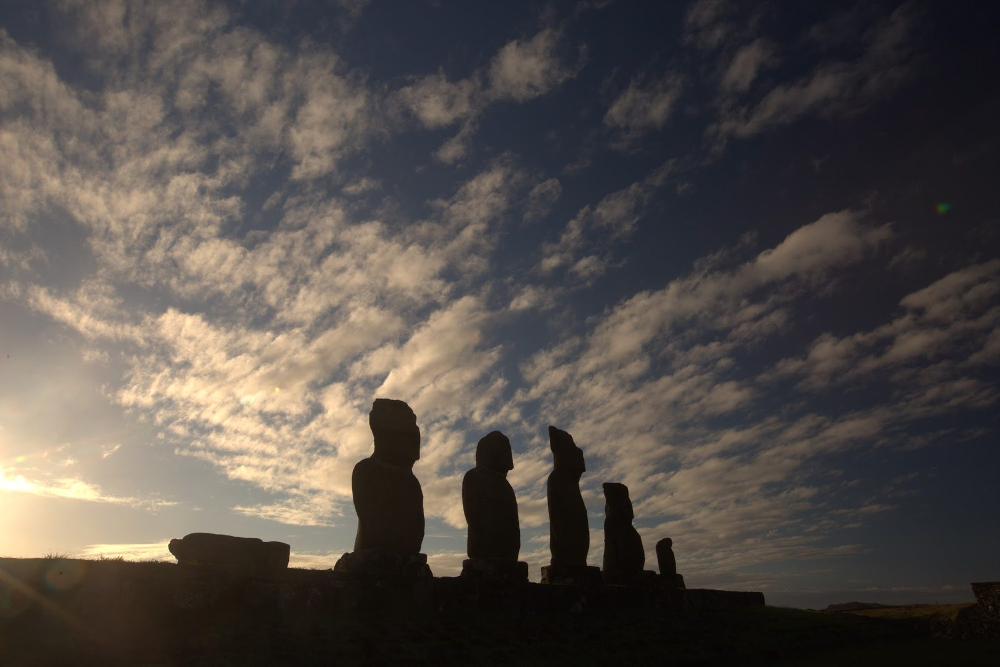
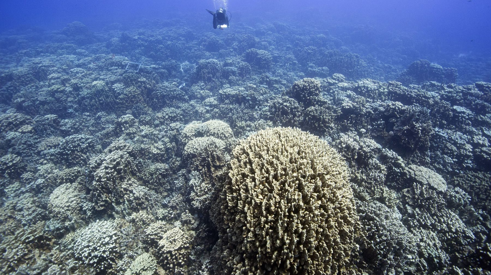
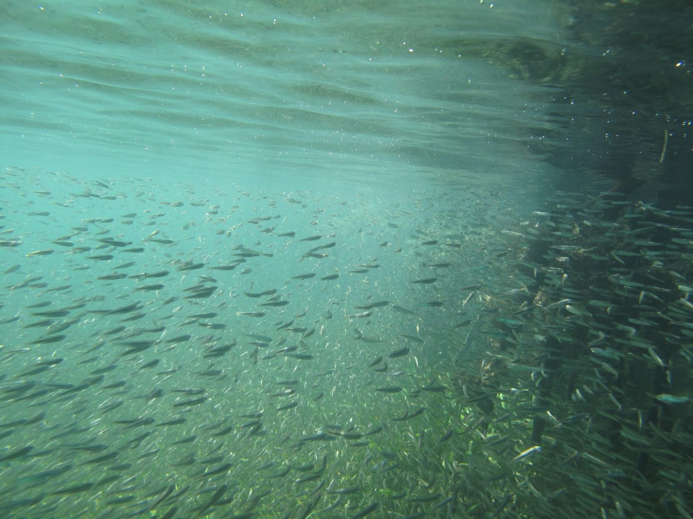
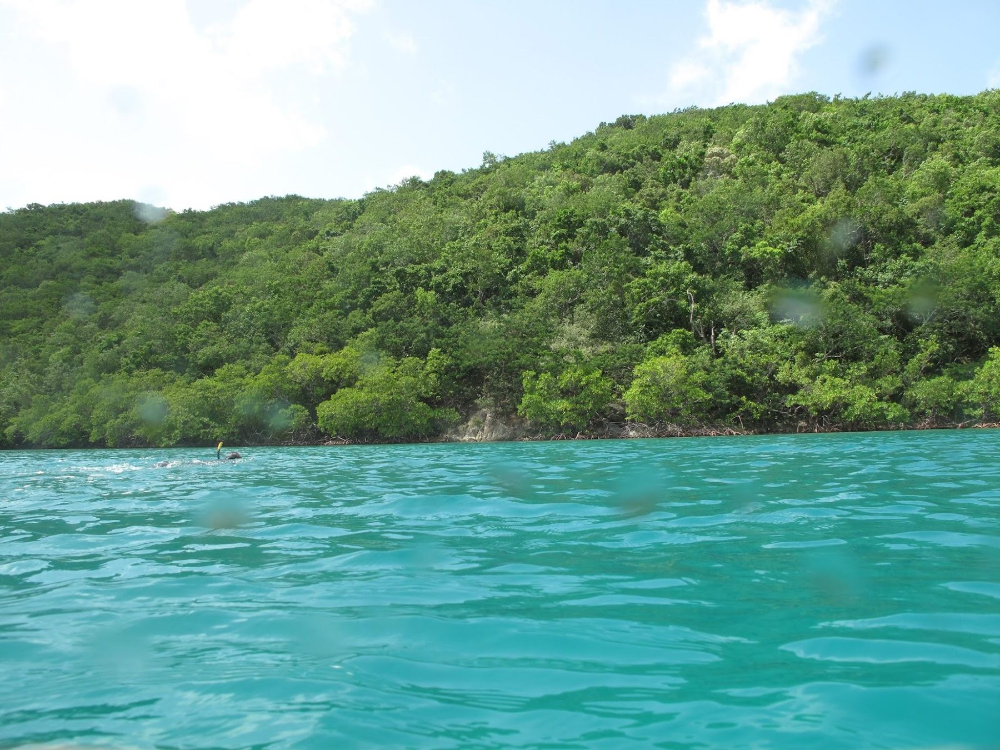
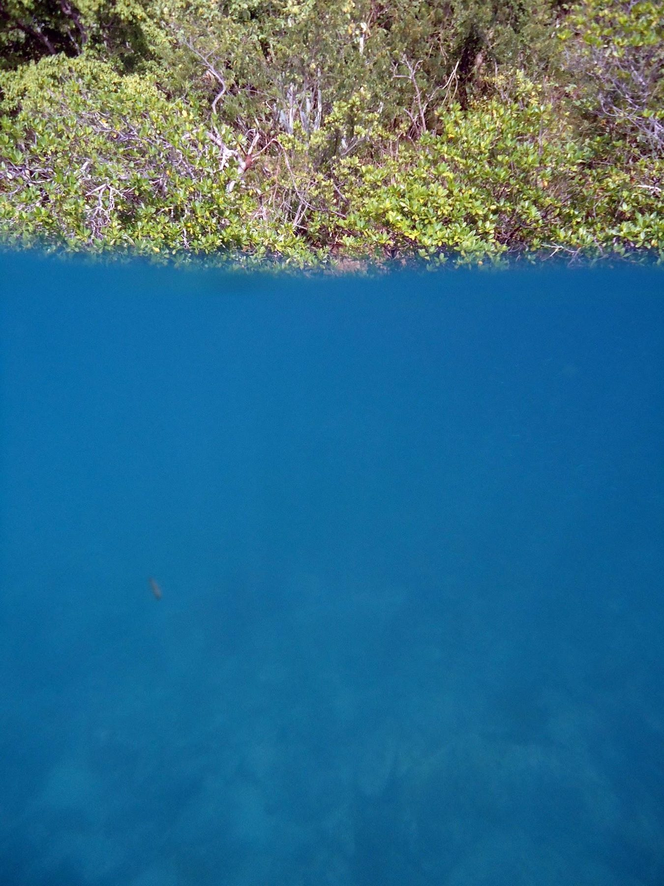

## Video

```{=html}
<div class="video-grid">
  <div>
    <iframe src="https://www.youtube-nocookie.com/embed/rb0NXtxAR24" title="Coral Reefs of Rapa Nui" loading="lazy" allow="accelerometer; encrypted-media; gyroscope; picture-in-picture" allowfullscreen></iframe>
    <p><strong>Coral Reefs of Rapa Nui</strong></p>
  </div>
  <div>
    <iframe src="https://www.youtube-nocookie.com/embed/ZGtkQhB8Y4I" title="Snorkeling a tide pool at Motu Motiro Hiva, September 2015" loading="lazy" allow="accelerometer; encrypted-media; gyroscope; picture-in-picture" allowfullscreen></iframe>
    <p><strong>Snorkeling a tide pool at Motu Motiro Hiva</strong> · September 2015</p>
  </div>
  <div>
    <iframe src="https://www.youtube-nocookie.com/embed/FroVweNDF3s" title="Reef video, Rapa Nui (RPN Man Dp 0425)" loading="lazy" allow="accelerometer; encrypted-media; gyroscope; picture-in-picture" allowfullscreen></iframe>
    <p><strong>RPN Man Dp 0425</strong></p>
  </div>
</div>
```

More on my [YouTube channel](https://www.youtube.com/@jamesherlan2388).

## Photographs

::: gallery
{fig-alt="Silhouettes of moai statues against a cloudy sunset sky." group="media"}

{fig-alt="A diver above a shallow reef with a large coral colony in front." group="media"}

{fig-alt="A dense field of branching Pocillopora corals." group="media"}

{fig-alt="Massive and branching corals on a reef slope in blue water." group="media"}

{fig-alt="A school of small fish over a sandy seafloor in green water." group="media"}

{fig-alt="Turquoise water in front of a hillside covered in green forest." group="media"}

{fig-alt="Arching red mangrove prop roots over calm water." group="media"}

{fig-alt="A split-level photo with shoreline vegetation above the waterline and blue water below." group="media"}

{fig-alt="A mangrove shoreline seen from water level in a turquoise bay." group="media"}
:::
