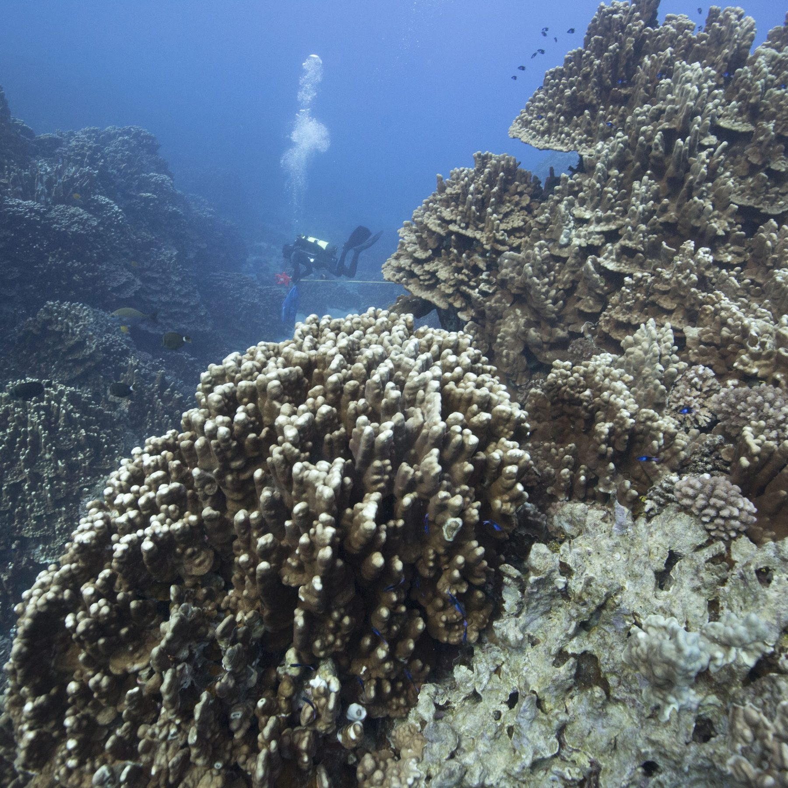
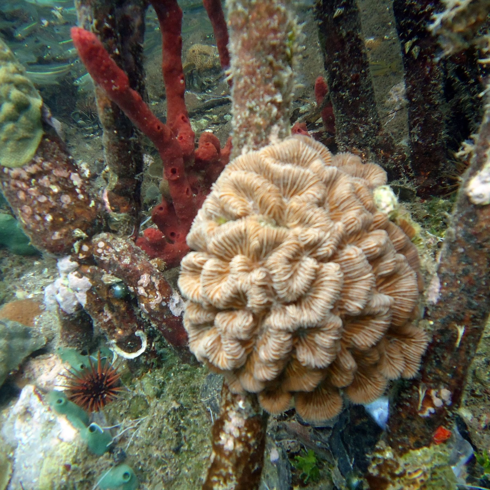
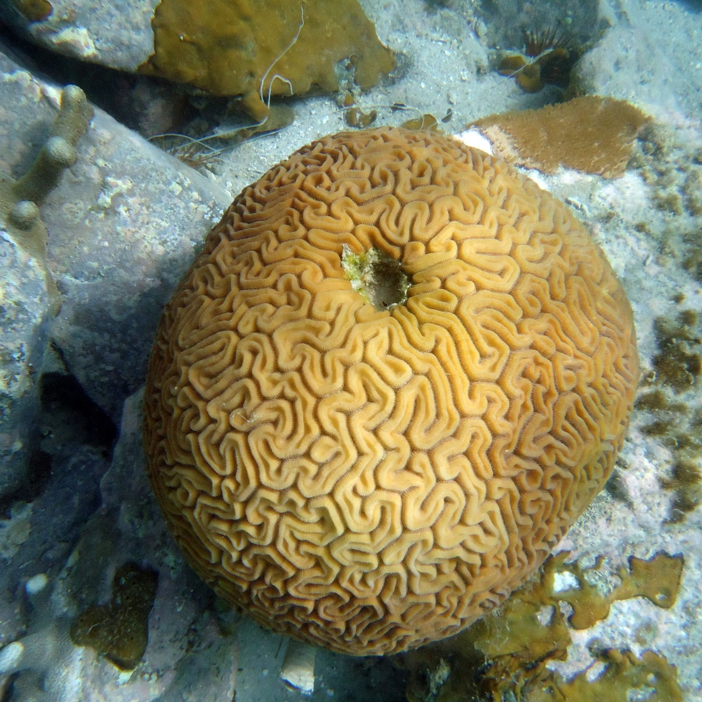
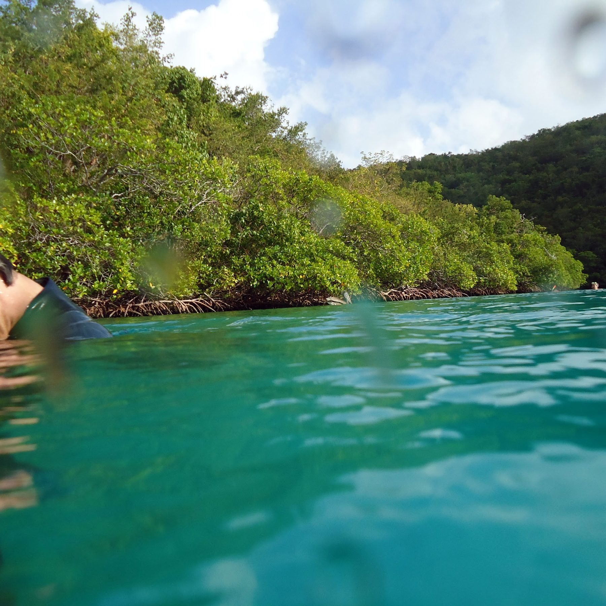
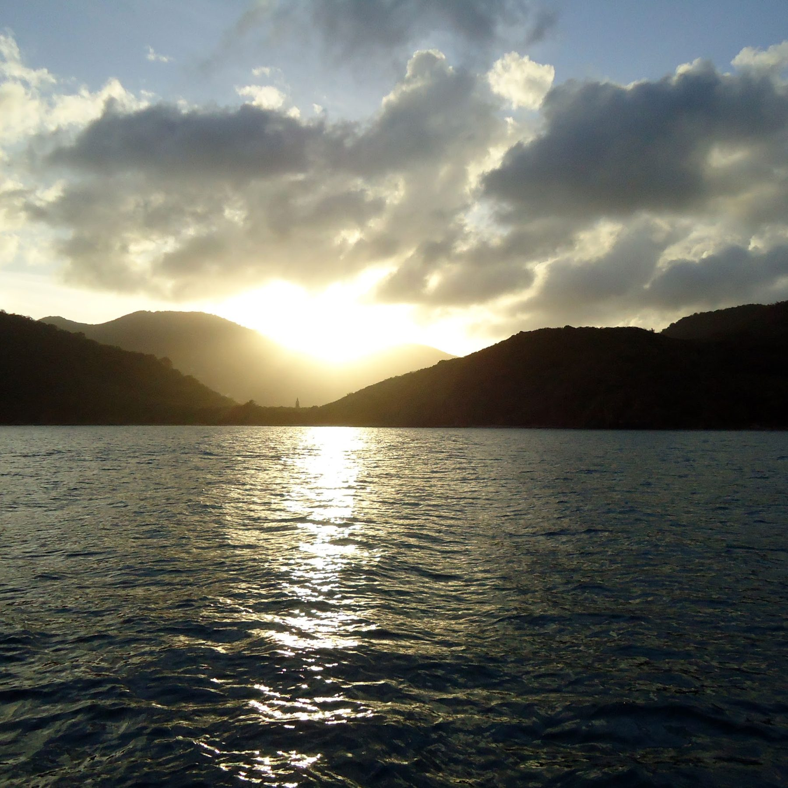
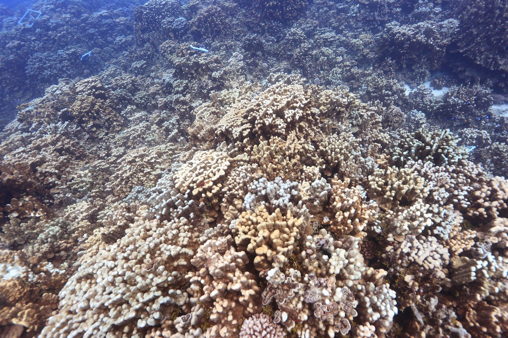
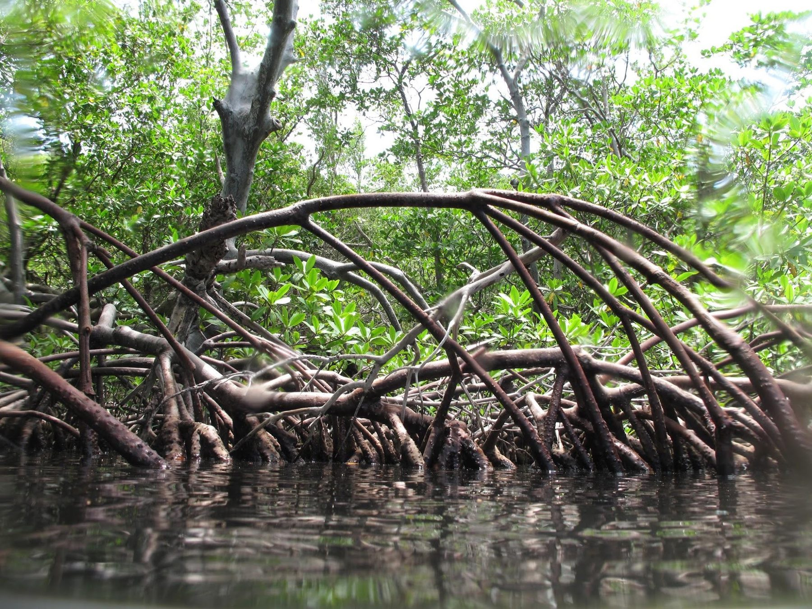
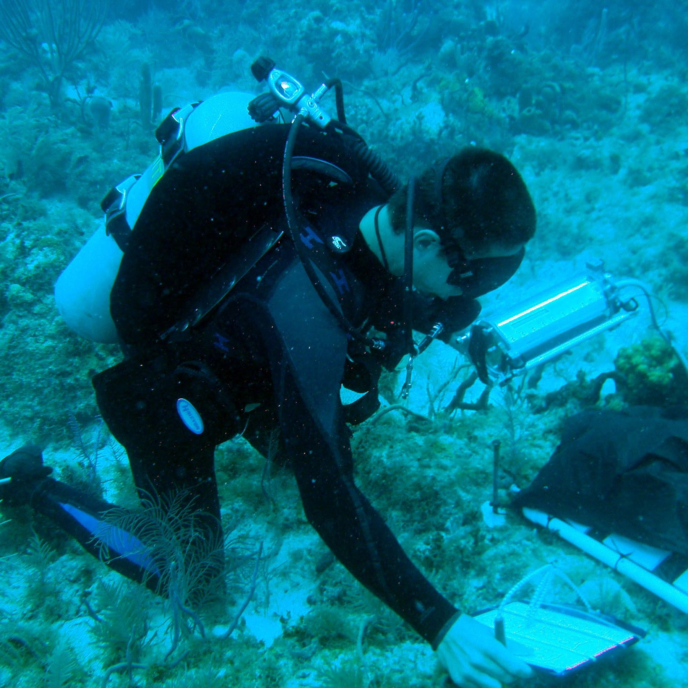

::: lead-text
Foundation species such as corals, marsh grasses and oysters build the habitat that everything else depends on. My work asks how physical forces, mainly waves and flow, and the structure these species build together decide where they persist. I work across three systems and use the same toolkit in each: field surveys, 3D imaging, spatial statistics and machine learning.
:::

## Reef assembly at Rapa Nui {#reef-assembly-at-rapa-nui}

::: theme-section
::: {}
My dissertation examines coral community assembly at Rapa Nui (Easter Island), one of the most isolated reef systems on Earth. With large-area imaging and Structure-from-Motion photogrammetry, I build high-resolution 3D models of the reef and map the position of every coral colony. Spatial point pattern analysis then helps separate biological processes, such as competition, fragmentation and recruitment, from environmental filters such as wave stress and the substrate available.

Along the island's wave exposure gradient, massive *Porites* dominate sheltered reefs, while *Pocillopora* thrive in high-energy zones by rapid colonization and fragmentation. How tightly colonies cluster or spread apart also shifts predictably along the gradient. Related work covers the first quantitative assessment of coral bleaching at Rapa Nui during the 2014–2017 global thermal event, and how dead *Pocillopora* skeletons mix with live colonies.

[Spatial point patterns]{.tag} [SfM photogrammetry]{.tag} [Large-area imaging]{.tag} [Wave exposure]{.tag}

**Key paper:** Herlan et al. 2026, *Marine Ecology Progress Series*. [doi:10.3354/meps15300](https://doi.org/10.3354/meps15300)
:::
::: {}
{fig-alt="Branching and massive corals on a reef at Manavai, Rapa Nui, with a diver in the background."}
:::
:::

## Seafloor habitat at shelf scale {#seafloor-habitat-at-shelf-scale}

::: theme-section
::: {}
As a NOAA NERTO Fellow at the James J. Howard Marine Sciences Laboratory (Sandy Hook, NJ), I built ensemble species distribution models (Random Forest, Gradient Boosting, XGBoost and neural networks) for deep-sea coral and sponge assemblages on the Northeast U.S. continental shelf. I'm comparing these models with NOAA NCCOS products. One goal is a parsimonious model of habitat for the cold-water coral *Desmophyllum dianthus* that can inform marine spatial planning. That work earned a best-poster award at the 2026 Education and Science Forum.

An earlier NERTO fellowship with NOAA NCCOS (2022) built 2D orthoprojections of coral reef plots in the Florida Keys National Marine Sanctuary for coral cover analysis in Viscore.

[Species distribution models]{.tag} [Ensemble machine learning]{.tag} [Marine spatial planning]{.tag}
:::
::: {}
{fig-alt="Cross-section diagram from coast to submarine canyon, with predicted coral and sponge habitat shaded along the slope."}
:::
:::

## Urban coastal restoration {#urban-coastal-restoration}

::: theme-section
::: {}
In New York Harbor I study how very local differences in waves and water level affect the restoration of oysters (*Crassostrea virginica*) and salt marsh (*Spartina alterniflora*). With the Hudson River Park Trust, I deploy arrays of tilt current meters and water level sensors to find where wave exposure stops helping restoration targets and starts hurting them.

**EcoAirML NYC** develops accessible machine learning tools that predict how atmospheric deposition affects urban coastal wetlands, starting at Jamaica Bay Wildlife Refuge. LoRaWAN sensor networks monitor wind-driven wave exposure at *Spartina* restoration sites. LSTM and LightGBM models link atmospheric nitrogen deposition to wetland biogeochemistry. The project is supported by PSC-CUNY and NSF-ESIP, with the Jamaica Bay-Rockaway Parks Conservancy and the National Park Service as partners.

Since August 2026, as a Research Associate with the North Atlantic Coast CESU, I've been building a process model of marsh loss at Horseshoe Cove (Sandy Hook) to inform management actions.

[Sensor networks]{.tag} [LSTM / LightGBM]{.tag} [Salt marsh]{.tag} [Oyster restoration]{.tag}
:::
::: {}
{fig-alt="A wind and weather sensor station on a tripod in a salt marsh under a blue sky."}
:::
:::

## Where this is going

::: callout-future
**From pattern to process in clonal corals.** Storms, bleaching and disease often break a coral colony into surviving fragments. My next research program asks when those remnants still behave as one integrated individual, and how fragment spacing and water flow decide that. My dissertation mapped *where* colonies sit. This program asks *how* colonies function after disturbance, combining field experiments with flow measurements and repeat 3D imaging. I plan to compare three systems: *Pocillopora* in Palau, the pillar coral *Dendrogyra cylindrus* in the U.S. Virgin Islands, and the temperate coral *Astrangia poculata* in New York waters.
:::

## Earlier work

- **Coral refugia in mangroves (USGS, St. John, 2010–2013).** Documented diverse coral communities in mangrove-lined bays of the Virgin Islands Coral Reef National Monument, and studied disease and survival in elkhorn coral, *Acropora palmata*. [Yates et al. 2014, *Biogeosciences*](https://doi.org/10.5194/bg-11-4321-2014).
- **Coral restoration (University of Miami, 2004–2009).** Developed nursery methods for the threatened staghorn coral, *Acropora cervicornis*. [Lirman et al. 2010, *Coral Reefs*](https://doi.org/10.1007/s00338-010-0621-6).

## Field photos

::: gallery
{fig-alt="A Colpophyllia natans boulder coral among mangrove prop roots with a red sponge." group="field"}

{fig-alt="A grooved brain coral, Diploria labyrinthiformis, on a rocky bottom." group="field"}

{fig-alt="A mangrove shoreline seen from water level in a turquoise bay." group="field"}

{fig-alt="Sunset over open water between green hills." group="field"}

{fig-alt="Branching and massive corals with a diver in the background." group="field"}

{fig-alt="A dense field of branching Pocillopora corals." group="field"}

{fig-alt="Arching red mangrove prop roots over calm water." group="field"}

{fig-alt="A scuba diver handling survey equipment on a reef." group="field"}
:::

## Support

My research has been supported by the NOAA Educational Partnership Program with Minority Serving Institutions (CESSRST-II, Grant NA22SEC4810016; earlier CESSRST, NA16SEC4810008), NOAA NERTO fellowships, the Hudson River Park Trust, PSC-CUNY, NSF-ESIP, the USGS/CCNY Internship Program, Idea Wild and crowdfunding through experiment.com.
